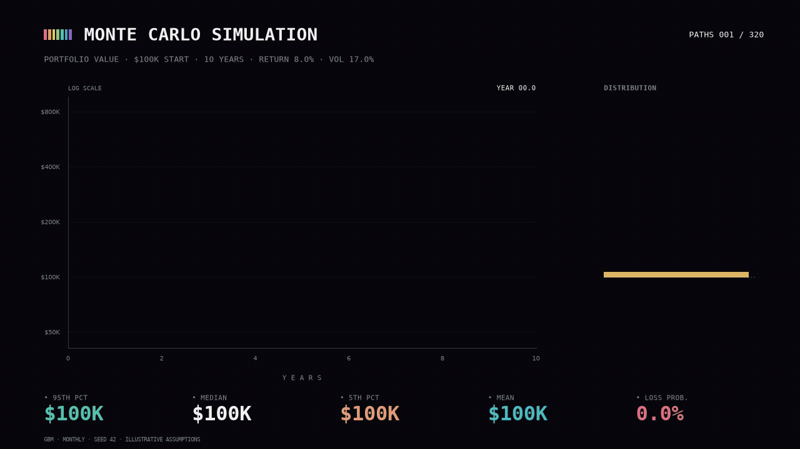
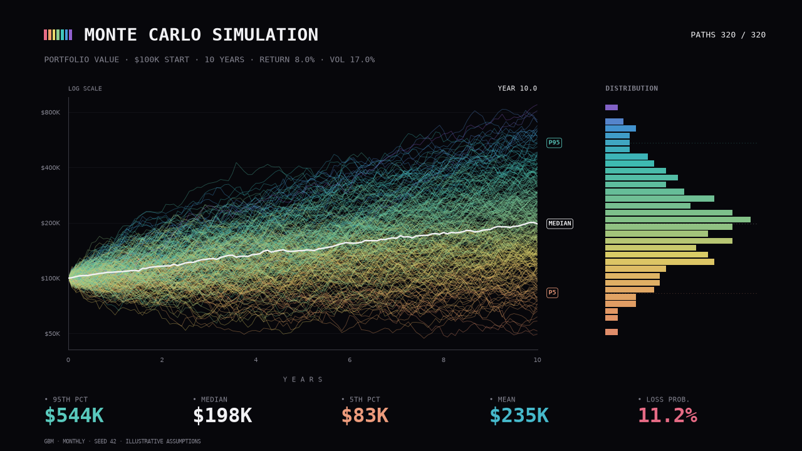

# Monte Carlo Portfolio Sim

**320 possible futures. One reproducible simulation.** Exact geometric Brownian motion in Python,
with a black canvas, outcome-colored paths, and ready-to-share 9:16 and 16:9 animations.
Optional B3 calibration; fully offline examples and tests.

[](https://github.com/VictorPimentaDev/monte-carlo-portfolio-sim/actions/workflows/ci.yml)
[](https://www.python.org/)
[](LICENSE)
[](https://colab.research.google.com/github/VictorPimentaDev/monte-carlo-portfolio-sim/blob/main/notebooks/portfolio_sim.ipynb)




Queria um gráfico que mostrasse o que uma média esconde. O resultado é este: 320 trajetórias,
uma mediana branca e uma distribuição que acompanha o tempo. Cada caminho mantém sua cor,
definida pelo valor final: coral, laranja, verde, teal, azul e roxo.

**Uso educacional. Não é recomendação de investimento.** As imagens acima usam premissas
ilustrativas, não projeções de WEGE3, IBOV ou qualquer carteira real.

## Rodar em dois minutos

```bash
git clone https://github.com/VictorPimentaDev/monte-carlo-portfolio-sim.git
cd monte-carlo-portfolio-sim
python -m venv .venv
source .venv/bin/activate  # Windows: .venv\Scripts\activate
pip install -e .
portfolio-sim --output output/demo
```

Cria `output/demo/simulation-wide.png` e `summary.json`. O PNG funciona sem display e sem ffmpeg.
Enquanto o repositório estiver privado, o clone exige acesso à conta autorizada.

```bash
# As mesmas premissas dos assets deste README.
python -m portfolio_sim --start 100000 --years 10 --return 0.08 --vol 0.17 --paths 320 --seed 42

# Reel + widescreen: PNG, MP4 e GIF, 8 segundos, 15 fps.
python -m portfolio_sim --layout both --formats png mp4 gif --seconds 8 --fps 15 --output output/video

# Outra hipótese, sem buscar dados de mercado.
portfolio-sim --start 50000 --years 5 --return 0.06 --vol 0.25 --seed 7 --layout vertical
```

MP4 e GIF exigem [ffmpeg](https://ffmpeg.org/download.html): `brew install ffmpeg` no macOS,
ou `sudo apt-get install ffmpeg` no Ubuntu. Ambos são renderizados por `matplotlib.animation`;
o GIF usa uma paleta de 128 cores via ffmpeg para controlar memória e tamanho.

| Flag | Padrão | Significado |
| --- | --- | --- |
| `--start` | `100000` | Valor inicial, na unidade monetária escolhida |
| `--years` | `10` | Horizonte positivo; frações de ano funcionam |
| `--return` | `0.08` | Drift anual μ, em decimal |
| `--vol` | `0.17` | Volatilidade anual σ, em decimal |
| `--paths` | `320` | Número de caminhos |
| `--seed` | `42` | Seed inteira, não negativa |
| `--ticker` / `--ibov` | — | Calibração opcional com preços ajustados |
| `--offline` | desligado | Calibra na fixture **sintética**, explicitamente |
| `--layout` | `wide` | `wide`, `vertical` ou `both` |
| `--formats` | `png` | Uma ou mais opções: `png mp4 gif` |
| `--seconds` / `--fps` | `8` / `15` | Duração e frequência da animação |
| `--output` | `output` | Diretório de exportação |

Os arquivos usam nomes fixos dentro de `--output`; uma nova execução substitui os exports
anteriores daquele layout/formato. Use pastas diferentes para comparar cenários.

## O modelo e os números

Em cada intervalo:

```text
V[t + Δt] = V[t] × exp((μ − σ²/2) × Δt + σ × √Δt × Z),   Z ~ N(0, 1)
```

São transições exatas do GBM em uma grade mensal, sem aproximação de Euler. Para horizontes
fracionários, `ceil(years × 12)` intervalos iguais fecham exatamente no ano solicitado.
Valores ficam positivos; entradas inválidas, overflow e pedidos acima de 20 milhões de amostras
são rejeitados com mensagem explícita.

`--return 0.08` significa μ = 8% ao ano no modelo contínuo. O crescimento esperado em um ano
é `exp(0.08) − 1 ≈ 8.33%`; não é CAGR garantido nem retorno mediano. Mediana e média divergem
porque o valor terminal segue uma distribuição lognormal.

| Estatística em 10 anos | 320 caminhos, seed 42 | Distribuição analítica |
| --- | ---: | ---: |
| Percentil 95 | $544,478 | $466,343 |
| Mediana | $197,649 | $192,611 |
| Percentil 5 | $83,177 | $79,553 |
| Média | $234,607 | $222,554 |
| Probabilidade de perda | 11.25% | 11.14% |

Os números vêm de [assets/summary.json](assets/summary.json), sem ajustes manuais.
320 caminhos funcionam bem para o visual, mas deixam bastante erro amostral nas caudas.
O teste estatístico usa 50 mil caminhos e compara momentos, quantis e probabilidade com a solução
analítica. Perda significa **valor final abaixo do inicial**, não drawdown durante a trajetória.
P5/P95 são percentis de desfechos do modelo, não um intervalo de confiança da estimativa.

### Como ler o gráfico

- O eixo vertical é **logarítmico**, identificado por `LOG SCALE`. Distâncias iguais representam
  multiplicadores iguais; não incrementos iguais em dinheiro. Nenhuma cauda é cortada.
- O histograma compartilha o eixo vertical e usa intervalos geométricos. Sua largura representa
  **contagem por intervalo**, não densidade por dólar; ela é normalizada visualmente a cada frame.
- A cor depende do valor terminal, com a mediana no centro da paleta. É informação retrospectiva
  para leitura, não um sinal disponível antes do futuro acontecer.
- `PATHS n / 320` informa quantos caminhos já foram revelados. Durante a animação, mediana,
  histograma e rodapé usam somente os caminhos visíveis naquele instante.
- `$` é uma unidade monetária genérica no visual. Não há conversão cambial; a calibração em B3
  usa retornos nominais em BRL de WEGE3.SA ou ^BVSP e pode ser aplicada a um valor inicial em reais.
  O gráfico não apresenta retorno em dólares nem converte BRL para USD.

O modelo assume μ e σ constantes, retornos lognormais independentes e ausência de saltos.
Não inclui aportes, rebalanceamento, impostos, taxas, inflação ou correlações entre ativos.
É uma carteira agregada com uma fonte de risco, não um otimizador multiativo.

## WEGE3, IBOV e origem dos dados

```bash
pip install -e '.[market]'
portfolio-sim --ticker WEGE3 --output output/wege-live
portfolio-sim --ibov --output output/ibov-live

# Sem rede: teste de calibração com dados SINTÉTICOS, não histórico de WEGE3.
portfolio-sim --ticker WEGE3 --offline --output output/offline
```

O adaptador usa cinco anos de fechamento diário ajustado, com `yfinance.download(auto_adjust=True)`.
`WEGE3` vira `WEGE3.SA`; `--ibov` usa `^BVSP`. A calibração substitui `--return` e `--vol`:

```text
r = log(P[t] / P[t−1])
σ = std(r, ddof=1) × √252
μ = mean(r) × 252 + σ²/2
```

A correção `σ²/2` evita usar média logarítmica como drift aritmético. 252 é uma convenção
de anualização. Preços precisam ser positivos, finitos, ordenados, sem datas repetidas e ter
ao menos 30 retornos. Lacunas na série não são preenchidas; períodos de suspensão podem afetar
a estimativa. O histórico não garante os parâmetros futuros.

`summary.json` registra símbolo, fonte, instante da consulta, datas inicial/final, observações
e método. Falha de download **não** troca dados reais por sintéticos silenciosamente: use
`--offline` de forma explícita. Não há credenciais no pacote.

A [fixture versionada](src/portfolio_sim/fixtures/provenance.json) contém 757 preços sintéticos,
gerados em 06/11/2026 com seed `20261106`, μ = 12% e σ = 25%. Usa dias de semana, não o calendário
de pregões da B3. O ticker pedido é registrado apenas como contexto; a fixture não representa
esse ativo. Para reconstruí-la: `python scripts/generate_fixture.py`.

Fontes de implementação: [documentação oficial de yfinance.download](https://ranaroussi.github.io/yfinance/reference/api/yfinance.download.html)
para ajustes e formato de preços; [NumPy Generator.standard_normal](https://numpy.org/doc/stable/reference/random/generated/numpy.random.Generator.standard_normal.html)
para os choques normais. O yfinance é um projeto independente; confira seus termos e os termos
do fornecedor antes de redistribuir dados. Nenhum histórico real acompanha o repositório.

## Notebook / Colab

[notebooks/portfolio_sim.ipynb](notebooks/portfolio_sim.ipynb) reproduz o cenário, confere a solução
analítica, renderiza ambos os layouts e demonstra a calibração offline.

**Enquanto este repo estiver privado:** baixe o notebook e o ZIP do código pelo GitHub autenticado.
No [Colab](https://colab.research.google.com/), use **File → Upload notebook**. A primeira célula pede
o ZIP do código e instala o pacote dentro da sessão. Nenhum token é necessário. O badge com link
direto ao GitHub será útil após a publicação; ele não contorna a privacidade do repo.

Localmente, instale o pacote e abra o notebook com seu Jupyter habitual. O núcleo do exemplo
também pode ser usado sem notebook:

```python
from portfolio_sim.model import Config, simulate, analytical_statistics
from portfolio_sim.render import export_png

result = simulate(
    Config(start=100_000, years=10, annual_return=0.08, volatility=0.17, paths=320, seed=42)
)
print(result.statistics)
print(analytical_statistics(result.config))
export_png(result, "output/portfolio.png", layout="wide")
```

## Exports prontos

| Layout | PNG | MP4 | GIF |
| --- | --- | --- | --- |
| 16:9 · 1280 × 720 | [Imagem](assets/simulation-wide.png) | [Vídeo](assets/simulation-wide.mp4) | [Animação](assets/simulation-wide.gif) |
| 9:16 · 720 × 1280 | [Imagem](assets/simulation-vertical.png) | [Vídeo](assets/simulation-vertical.mp4) | [Animação](assets/simulation-vertical.gif) |

Ambos os vídeos têm 8 segundos e 15 fps. Os GIFs preservam as dimensões; o formato quantiza a duração
dos frames para centésimos de segundo. `python scripts/verify_assets.py` verifica tamanho,
duração e dimensões dos arquivos. Para reconstruir a imagem social original de 1280 × 640:
`python scripts/social_preview.py`. [Social preview](assets/social-preview.png) pronto para
ativar nas configurações do GitHub após a publicação.

## Testes

```bash
pip install -e '.[dev]'
ruff check .
ruff format --check .
pytest -q
```

CI executa Ruff e pytest em Python 3.11/3.13 sem buscar preços. O smoke MP4/GIF tem skip explícito
quando ffmpeg não existe; um job separado instala ffmpeg e roda a codificação real.
Testes cobrem seed, positividade, retorno determinístico, momentos/quantis analíticos,
calibração, dados ruins, escala log, histogramas, CLI, PNG e animações.

Ideias e correções são bem-vindas; veja [CONTRIBUTING.md](CONTRIBUTING.md). Licença [MIT](LICENSE).
